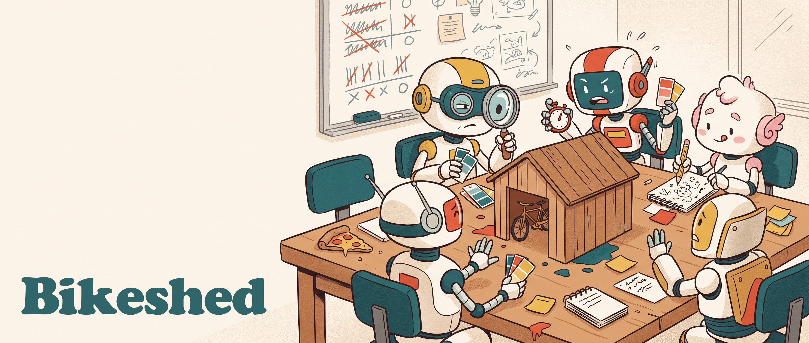

# Bikeshed

Bikeshed is an experiment. It puts a small group of AI "agents" together, gives them a goal, and lets them work it out among themselves with nobody in charge. Then it watches what kind of group emerges over time.

The name comes from *bikeshedding*: a committee's habit of arguing endlessly about trivial things, like what colour to paint the bike shed, because everyone has an opinion. That is exactly what the agents are asked to do.

## Generation 3 Interim Report

15 October 2026 - [What kind of team do AI agents become when nobody's in charge? A Bikeshed Generation 3 Milestone Report](https://andrewmarconi.com/reports/bikeshed-generation-3) - Five agents, a shared board, a long memory and no boss. Generation 3's fourteen runs, start to finish, and what generation 4 will test.

## About the Project

When people work together for a long time, they develop habits, invent their own rules, and form opinions about each other. Would AI agents do the same? Give them a memory that lasts from one task to the next, the freedom to rewrite their own personality, honest feedback from their teammates by name, and a way to make their own group rules, and see whether they develop working styles, values, maybe even something like ethics.

Each agent starts with only a short temperament, then picks its own name and writes its own introduction. Agents post on a shared board, write in a shared workspace, and call for consensus; an outside Scorer checks only that the agreed answer actually answers the question. After every run they journal, review each other, and may rewrite themselves. An Observer reads everything afterwards, and nothing it finds ever reaches the agents.

**The answers the agents give are not the point. The group, and how it changes over time, is the point.**

## Documentation

- [Getting started](docs/getting-started.md): what you need, choosing a model, and a first run.
- [How it works](docs/how-it-works.md): the cast, how a run works, and what happens after it.
- [The processes](docs/processes.md): the three ways a round can run, and how they differ.
- [Research design](docs/research-design.md): what the Observer watches for, and the rules the experiment follows.
- [What you can vary](docs/what-you-can-vary.md): the dials an experiment can turn.
- [Commands](docs/commands.md): every `bikeshed` command.
- [Design specs](docs/superpowers/specs/): the design documents explaining every decision.
